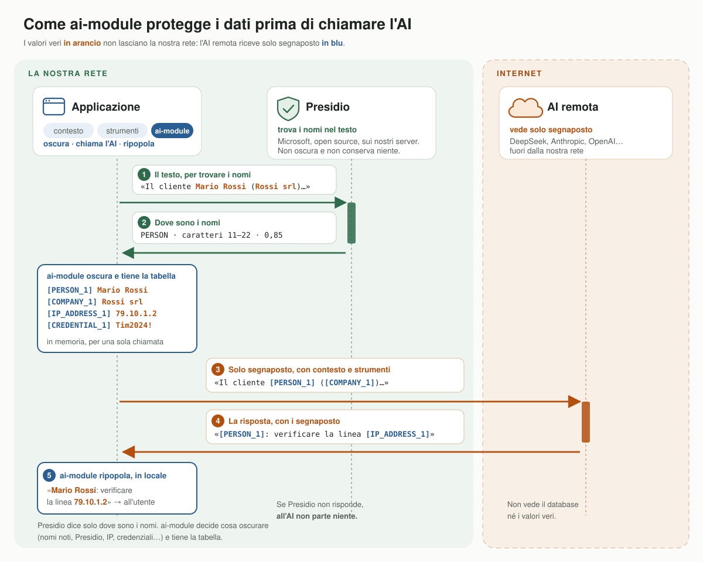
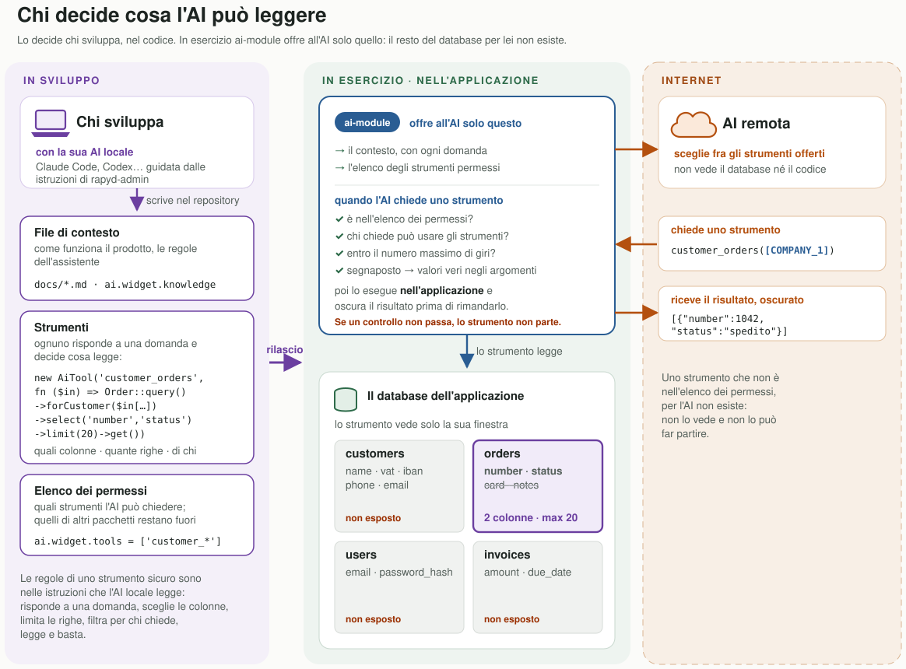

# Protezione dei dati

Come ai-module tiene i dati personali di un'applicazione lontani dal servizio AI, e cosa non può fare.

## Il percorso di una domanda

1. **La richiesta si prepara dentro l'applicazione.** ai-module mette insieme le istruzioni (`ai.widget.system_prompt`),
   la conoscenza del prodotto (`ai.widget.knowledge`: file, una cartella, un wiki), i messaggi e **gli strumenti
   permessi** (`ai.widget.tools`). Uno strumento registrato da un pacchetto e lasciato fuori dall'elenco, come il lettore
   del log di rapyd-admin, non viene né offerto né eseguito.
2. **Tutto quello che esce viene oscurato.** Ogni dato personale diventa un segnaposto, uguale per lo stesso valore per
   tutta la chiamata: `[PERSON_1]`, `[COMPANY_2]`, `[IP_ADDRESS_1]`. Lavorano insieme tre fonti:
   - **i nomi noti** (`ai.redact.terms`): clienti, aziende e dispositivi che l'applicazione conosce già, riconosciuti
     esattamente, i più lunghi per primi;
   - **gli schemi**: indirizzi IPv4 e IPv6 (pubblici e privati), indirizzi MAC, e-mail, IBAN, telefoni, nomi di dominio
     e credenziali;
   - **Microsoft Presidio**, installato sui propri server: i nomi di persona nel testo libero.
3. **Il servizio AI legge solo segnaposto.** Può ragionarci sopra («[COMPANY_1] ha due linee giù») senza sapere chi o
   cosa siano.
4. **Gli strumenti girano dentro l'applicazione.** Quando il modello chiede uno strumento, ai-module rimette i valori
   veri negli argomenti, esegue lo strumento sui dati dell'applicazione e ne oscura il risultato prima di rimandarlo. Il
   modello non interroga mai un database.
5. **La risposta torna con i segnaposto,** e ai-module rimette i valori veri prima che l'utente la legga.

## Chi decide cosa l'AI può leggere

Lo decide chi sviluppa, nel codice, spesso con un'AI locale guidata dalle istruzioni di rapyd-admin: i file di contesto,
gli strumenti e l'elenco dei permessi. In esercizio ai-module offre all'AI solo quelli. Il contesto (istruzioni e
conoscenza) va con ogni domanda, oscurato con i nomi noti e gli schemi. Uno strumento è codice del tuo modulo: un `AiTool` con un nome, una descrizione, i parametri e una funzione che decide cosa legge. Prima che
parta, ai-module controlla che sia fra quelli permessi, che l'utente possa usare gli strumenti (un ospite mai), che i
giri siano entro `ai.widget.max_tool_rounds`, e rimette i valori veri negli argomenti. Il suo risultato viene oscurato
prima di tornare. Uno strumento sicuro:

1. risponde a una domanda, non apre una tabella («le linee di un cliente», non «leggi la tabella lines»);
2. sceglie le colonne che servono alla risposta, mai password, note o contatti;
3. limita le righe e dice quando ha tagliato; meglio totali e conteggi che elenchi lunghi;
4. filtra per chi chiede quando i dati appartengono a un'azienda o a un utente;
5. legge e basta. Gli strumenti registrati da altri pacchetti restano fuori finché non sono in `ai.widget.tools`.

## Cosa non esce mai

- il database: il modello chiede uno strumento, lo strumento gira nell'applicazione;
- la corrispondenza fra segnaposto e valori veri: in memoria, per una sola chiamata;
- i valori veri della risposta: li legge solo chi ha fatto la domanda.

## Le garanzie nella configurazione

| Impostazione | Effetto |
|---|---|
| `ai.redact.enabled` | il filtro è acceso per i servizi in `ai.redact.providers` (un Ollama locale non si filtra, se non è nell'elenco) |
| `ai.redact.on_error=block` | se Presidio non risponde, al servizio AI non parte niente (`AiRedactionException`) |
| `ai.redact.keep` | le parole mai oscurate: il gergo del prodotto e i nomi pubblici che servono all'assistente |
| `ai.widget.tools` | l'elenco degli strumenti permessi: il modello può chiedere quelli e nient'altro |
| tetto di spesa, limiti, storia | spesa giornaliera, richieste per sessione e per indirizzo, lunghezza dei messaggi, ultimi N messaggi |
| `ai_usage` | ogni chiamata al servizio AI è contata con i suoi token e il suo costo (`php artisan ai:usage`) |

Presidio legge i messaggi e i risultati degli strumenti, mai le istruzioni e la conoscenza: le ha scritte
l'applicazione, e Presidio prenderebbe le parole di un manuale per luoghi, aziende e persone. Nomi noti e schemi valgono
anche lì.

## Cosa nessun filtro riconosce

- una password scritta senza nessuna parola vicina («ho messo Tim2024! e ora va»): le credenziali si riconoscono da una
  parola chiave («password:», «pin», «chiave wifi del modem =», «admin/admin»);
- un'azienda che non è fra i nomi noti e non sembra un nome di persona;
- il senso della domanda: il servizio AI sa che «[COMPANY_1] ha una linea giù», non chi sia [COMPANY_1].

Configurazione ed esempi: la sezione [Personal data filter](../README.md#personal-data-filter) del README.
