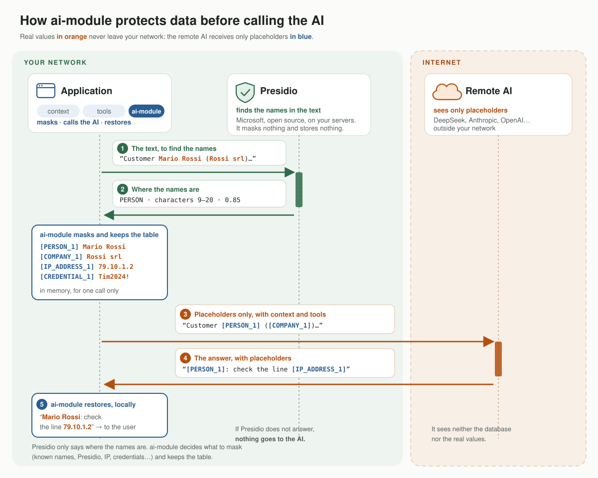
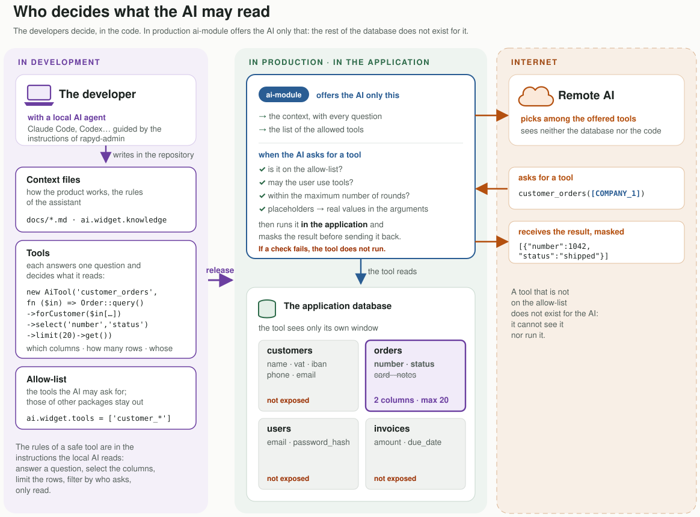

# Data protection

How ai-module keeps the personal data of an application away from the AI provider, and what it cannot do.

## The path of a question

1. **The request is built inside the application.** ai-module puts together the instructions (`ai.widget.system_prompt`),
   the knowledge of the product (`ai.widget.knowledge`: files, a directory, a wiki), the messages, and the **tools on the
   allow-list** (`ai.widget.tools`). A tool registered by a package and left out of the list, such as the log reader of
   rapyd-admin, is neither offered nor executed.
2. **Everything that leaves is redacted.** Every personal value becomes a placeholder, the same for the same value during
   the call: `[PERSON_1]`, `[COMPANY_2]`, `[IP_ADDRESS_1]`. Three sources work together:
   - **known names** (`ai.redact.terms`): the customers, companies and devices the application already has, matched
     exactly, the longest first;
   - **patterns**: IPv4 and IPv6 addresses (public and private), MAC addresses, e-mail, IBAN, phone numbers, host
     names and credentials;
   - **Microsoft Presidio**, self-hosted: the names of people in free text.
3. **The provider reads placeholders only.** It can reason on them ("[COMPANY_1] has two lines down") without knowing
   who or what they are.
4. **Tools run inside the application.** When the model asks for a tool, ai-module puts the real values back in the
   arguments, runs the tool against the application's own data, and redacts its result before it goes back. The model
   never queries a database.
5. **The answer comes back with placeholders,** and ai-module puts the real values back before the user reads it.

## Who decides what the AI may read

The developers decide, in the code, often with a local AI agent guided by the instructions of rapyd-admin: the context
files, the tools and the allow-list. In production ai-module offers the AI only those. The context (instructions and
knowledge) goes with every question, masked with the known names and the patterns. A tool is code of your module: an `AiTool` with a name, a description, the parameters and a function that decides
what it reads. Before it runs, ai-module checks that it is on the allow-list, that the user may use tools (a guest
never does), that the rounds are within `ai.widget.max_tool_rounds`, and puts the real values back in the arguments.
Its result is masked before it goes back. A safe tool:

1. answers a question, it does not open a table ("the lines of a customer", not "read the lines table");
2. selects the columns the answer needs, never passwords, notes or contacts;
3. limits the rows and says when it cut; totals and counts beat long lists;
4. filters by who asks when the data belong to a company or a user;
5. only reads. Tools registered by other packages stay out until they are in `ai.widget.tools`.

## What never leaves

- the database: the model asks for a tool, the tool runs in the application;
- the map between placeholders and real values: in memory, for one call;
- the real values of the answer: only the user who asked reads them.

## Guarantees in the configuration

| Setting | Effect |
|---|---|
| `ai.redact.enabled` | the filter is on for the providers in `ai.redact.providers` (a local Ollama is not filtered unless listed) |
| `ai.redact.on_error=block` | if Presidio does not answer, nothing is sent to the provider (`AiRedactionException`) |
| `ai.redact.keep` | the words never masked: the jargon of the product and the public names the assistant needs |
| `ai.widget.tools` | the allow-list of the tools: what the model may ask for, nothing else |
| budget, rate limits, history | daily budget, requests per session and per IP, message length, last N messages |
| `ai_usage` | every call to the provider is counted with its tokens and cost (`php artisan ai:usage`) |

Presidio reads the messages and the tool results, never the instructions and the knowledge: the application wrote
those, and Presidio would take the words of a manual for places, companies and people. Known names and patterns still
apply to them.

## What no filter can tell

- a password written with no word near it ("I set Tim2024! and now it works"): credentials are recognised from a
  keyword ("password:", "pin", "chiave wifi del modem =", "admin/admin");
- a company that is not among the known names and does not look like a person's name;
- the meaning of the question: the provider knows that "[COMPANY_1] has a line down", not who [COMPANY_1] is.

Configuration and examples: the [Personal data filter](../README.md#personal-data-filter) section of the README.
